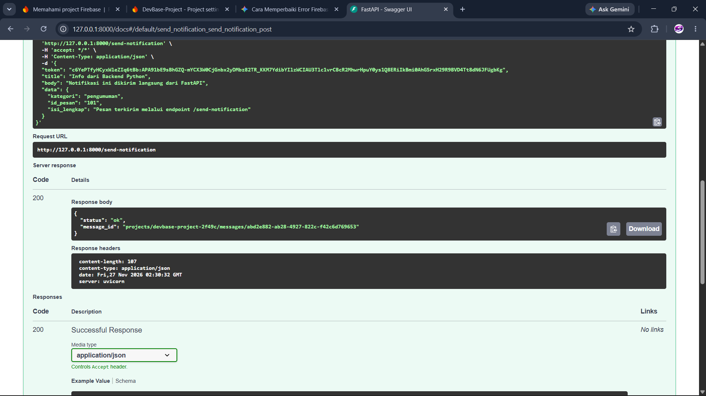
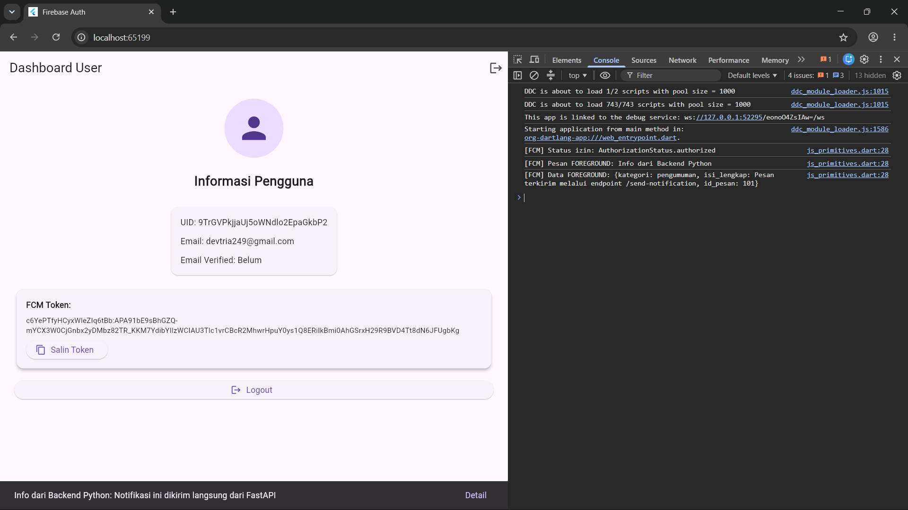

# flutter_assignment_8

### Hasil Pengujian Backend FastAPI & FCM

1. **Eksekusi Endpoint `POST /send-notification` di Swagger UI (`200 OK`)**
   

2. **Penerimaan Notifikasi & Data Payload di Flutter Web**
   

   
